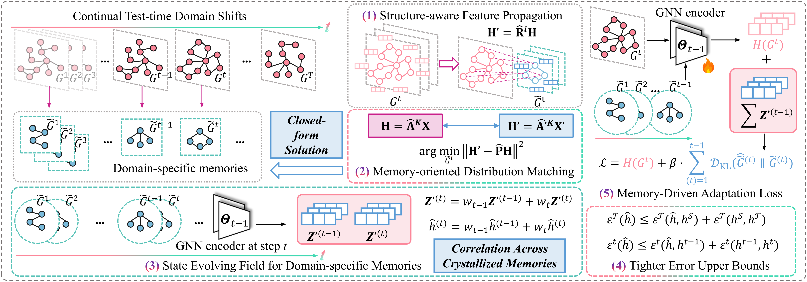

# [NeurIPS 2026] Efficient Memory Crystallization for Graph Learning under Non-Stationary Distribution Shifts

This repository is the official implementation of "Efficient Memory Crystallization for Graph Learning under Non-Stationary Distribution Shifts" accepted by the 40th Conference on Neural Information Processing Systems (NeurIPS 2026).

[](https://arxiv.org/pdf/2610.02795)

---

## 0. Abstract

Deep graph learning models deployed in real-world systems often need to cope with
non-stationary environments, where the underlying graph distribution drifts continually
over time. Prevailing solutions rely on training auxiliary generative modules to
synthesize memory graphs for cross-domain adaptation, which incurs substantial
computational overhead and scales poorly under prolonged distribution shifts. We argue
that a more economical path exists: rather than generating memory, one can *crystallize*
it. To this end, we propose **Efficient Memory Crystallization (EMC)**, a training-free
test-time framework that distills each incoming graph domain into a compact, semantically
faithful memory through a closed-form solution to a memory-oriented distribution-matching
objective, thereby eliminating redundant domain information under continual covariate
shifts. To preserve both generalizability and adaptability as the model traverses a long
sequence of target domains, EMC further models inter-domain dependencies through
state-evolving memories and admits a theoretically grounded, tighter generalization error
bound than direct adaptation. Extensive experiments demonstrate the superior performance
of EMC over state-of-the-art baselines on graphs under non-stationary distribution shifts,
while reducing average runtime by 87.4% and GPU memory consumption by 92.4% relative to
the recent competitor, making continual graph adaptation practical at scale.

---

## 1. Repository structure

```
EMC/
├── main.py                  # main table: EMC on real-world domain sequences
├── main_gcal.py             # GCAL baseline on the same sequences
├── methods.py               # EMC and GCAL test-time adapters
├── graph_cond.py            # closed-form memory condensation
├── model.py                 # GNN wrapper (GCN / SAGE / GAT / GIN)
├── nets.py                  # backbone implementations
├── data_process.py          # benchmark loading and domain construction
├── validation.py            # task metrics (AUC / macro-F1 / accuracy)
├── pretrain.py              # optional source-model grid search
├── scaling.py               # runtime and GPU-memory scaling study
├── scaling_condense.py      # condensation-stage microbenchmark
├── sequence.py              # domain-order and cyclic-shift experiments
├── scripts/
│   ├── _common.sh           # shared launcher and log helpers
│   ├── run_main.sh          # main table
│   ├── run_ablation.sh      # ablation study
│   ├── run_gcal.sh          # GCAL baseline
│   ├── run_scaling.sh       # scaling study
│   └── run_sequence.sh      # order / cyclic-shift study
├── requirements.txt
└── data/                    # datasets; ignored by git (see Section 3)
```

`methods.py` exposes two adapters:

* `EMC` — our method. It adapts the source model to each target domain with an entropy
  objective and replays a compact memory obtained by closed-form graph condensation.
* `GCAL` — the recent generative-memory baseline used for comparison.

The ablation variants are selected at run time with `--ablation`; no source editing is
required.

---

## 2. Installation

The pinned versions in `requirements.txt` are the ones used in our experiments.  A
CUDA-enabled GPU is required for the reported efficiency results; the code also runs on
CPU for small graphs.

```bash
conda create -n emc python=3.10 -y
conda activate emc

# Install the PyG extension wheels matching your CUDA toolkit first, e.g. CUDA 11.8:
pip install torch==2.2.1 --index-url https://download.pytorch.org/whl/cu118
pip install torch-scatter==2.1.2 torch-sparse==0.6.18 torch-cluster==1.6.3 \
    torch-spline-conv==1.2.2 -f https://data.pyg.org/whl/torch-2.2.0+cu118.html

pip install -r requirements.txt
```

If your CUDA version differs, install the corresponding PyTorch and PyG wheels from
<https://pytorch.org/get-started/locally/> and <https://data.pyg.org/whl/>.  The pure
Python dependencies are otherwise version-independent within the ranges pinned above.

---

## 3. Data preparation

All datasets live under `data/` and are excluded from version control.  `load_data()`
builds a cached pickle `data/<dataset>/<dataset>.pkl` on first use; delete that file after
changing the raw data or the preprocessing.

```text
data/
├── twitch/
│   ├── DE/   musae_DE_edges.csv, musae_DE_target.csv, musae_DE_features.json
│   ├── ENGB/ ...
│   ├── ES/ ...
│   ├── FR/ ...
│   ├── PTBR/ ...
│   ├── RU/ ...
│   └── TW/ ...
├── fb100/
│   ├── Amherst41.mat, Caltech36.mat, Johns Hopkins55.mat, ...
│   └── fb100.pkl                 # generated cache
├── ogbn_arxiv/
│   └── raw/                      # OGB node-feature / edge / label / year files
└── elliptic/
    ├── 0.pkl, 1.pkl, ..., 48.pkl
    └── elliptic.pkl              # generated cache
```

| Dataset | Source | Expected layout |
|---|---|---|
| **Twitch** | [MUSAE](https://github.com/benedekrozemberczki/MUSAE) | `data/twitch/<LANG>/musae_<LANG>_{edges.csv,target.csv,features.json}` for `DE, ENGB, ES, FR, PTBR, RU, TW` |
| **Facebook100** | [SNAP facebook100](https://snap.stanford.edu/data/facebook100.html) | `data/fb100/<graph>.mat`; each file must contain `A` (adjacency) and `local_info` |
| **ogbn-arxiv** | [OGB](https://ogb.stanford.edu/docs/nodeprop/#ogbn-arxiv) | downloaded automatically by `ogb` under `data/ogbn_arxiv/` on first run |
| **Elliptic** | [Kaggle Elliptic](https://www.kaggle.com/datasets/ellipticco/elliptic-data-set) | one pickle per time step, `data/elliptic/{0..48}.pkl` |

For Elliptic, each pickle is a tuple `(A, labels, features)`:

* `A` — `scipy.sparse` adjacency matrix of shape `(n, n)` for one time step;
* `labels` — integer array of shape `(n,)`, with `-1` for unlabeled nodes and `0/1` for
  the two classes;
* `features` — `float` array of shape `(n, 165)`.

The time-step index `i` in `data/elliptic/i.pkl` corresponds to Elliptic time step `i + 1`.

### Domain splits

| Dataset | Source domains | Target domains |
|---|---|---|
| Twitch | `DE` | `ENGB, ES, FR, PTBR, RU, TW` |
| Facebook100 | `Amherst41, Caltech36, Johns Hopkins55` | the 11 remaining graphs |
| ogbn-arxiv | papers from 1971–2010 | one graph per year, 2011–2020 |
| Elliptic | pickle indices 6–8 (raw time steps 7–9) | pickle indices 9–48 (raw time steps 10–49) |

The source model is trained on the source domains only.  Every target domain is then
presented once, in the order above, and the model is adapted test-time via EMC.

---

## 4. Evaluation protocol

For each target step `i`, the script records the score on every domain seen so far.  The
result is a matrix `R` where `R[0, 0]` is the source-domain score and `R[i, j]` is the
score on domain `j` after adapting through domain `i` (source column `j = 0`).  The
reported summary metrics are:

| Metric | Definition |
|---|---|
| **Acc** | mean score over the source domain and all target domains after the last step |
| **Gain** | average improvement of past-domain scores caused by adaptation |
| **TDA** | target-domain accuracy: mean of the diagonal `R[i, i]` |
| **TDG** | target-domain generalisation: mean of the lower triangle `R[i, j], j < i` |
| **FA** | forgetting: mean of `R[j, i]` for `j > i`, i.e. earlier domains after later adaptation |

The score is ROC-AUC for Twitch, macro-F1 for Elliptic, and accuracy for Facebook100 and
ogbn-arxiv.  The main, ablation, baseline and sequence scripts report `mean ± std` over
repeated adaptation trials and also print wall-clock time and peak GPU memory;
`scaling.py` reports the time and memory for a single sequence.

---

## 5. Running the experiments

All launchers source `scripts/_common.sh`, write to `logs/<experiment>/` and accept the
following environment variables where applicable:

```bash
DEVICE=0          # CUDA device id
SEED=0            # random seed
```

Other defaults, including the number of adaptation trials, are defined in
`scripts/_common.sh`.

### 5.1 Main table

```bash
bash scripts/run_main.sh
```

This runs EMC on all four datasets and all four backbones (16 configurations).  Logs are
written to `logs/main/<dataset>-<model>.log`.

Per-dataset settings are defined in `scripts/_common.sh`; adjust them there or override
them on the command line.

A single configuration can be run directly:

```bash
python main.py --dataset twitch --model gcn --device 0 --seed 0
```

If `checkpoints/<dataset>_<model>_best.pt` does not exist, `main.py` trains the source
model automatically and caches it.  Use `--retrain` to ignore an existing checkpoint.
For a dedicated source-model search:

```bash
python pretrain.py --dataset twitch --model gcn
python pretrain.py --dataset ogbn-arxiv --model sage
```

The grid search and training schedule can be adjusted in `pretrain.py`.

### 5.2 Ablation study

```bash
bash scripts/run_ablation.sh
```

The script runs three variants on the same configurations as the main table:

| `--ablation` | Description |
|---|---|
| `full` | EMC with condensed-memory replay (reference) |
| `no_replay` | removes replay of the condensed memory |
| `no_condensation` | replays raw target graphs instead of condensed memories |

Logs are written to `logs/ablation/<variant>-<dataset>-<model>.log`.  Run a subset with:

```bash
ABLATIONS="no_replay no_condensation" bash scripts/run_ablation.sh
```

A single ablation run:

```bash
python main.py --dataset twitch --model gcn --ablation no_condensation
```

### 5.3 Scaling study

The scaling study uses synthetic Erdős–Rényi graphs so that the number of nodes and the
number of domains can be controlled independently.

```bash
# Node scaling: 1k -> 30k nodes, 11 domains
bash scripts/run_scaling.sh nodes

# Domain scaling: 10k nodes, 11 -> 81 domains
bash scripts/run_scaling.sh domains

# Optional GCAL reference at 25k / 30k nodes
bash scripts/run_scaling.sh baseline

# All of the above
bash scripts/run_scaling.sh all
```

Logs are written to `logs/scaling/`.  Each run reports the wall-clock time and peak GPU
memory needed to adapt to the whole sequence.  Run a single point directly:

```bash
python scaling.py --method emc --num_nodes 10000 --num_graphs 21
python scaling.py --method gcal --num_nodes 25000 --num_graphs 11
```

To decompose the cost of the condensation stage itself (label generation, propagation,
closed-form solve, masking, adjacency construction):

```bash
python scaling_condense.py --num_nodes 10000 --estimate_nodes 100000000
```

This microbenchmark does not require a model and reports per-stage timings together with
dense-memory estimates for a larger theoretical graph size.

### 5.4 Domain order and cyclic shifts

```bash
bash scripts/run_sequence.sh
```

The script evaluates the Twitch stream in the canonical order, two shuffled orders, and
three repeated/cyclic orders.  Score matrices are saved as CSV files under
`results/sequence/` and logs under `logs/sequence/`.  Use the GCAL adapter with:

```bash
METHOD=gcal bash scripts/run_sequence.sh
```

A single sequence can be run directly:

```bash
python sequence.py --dataset twitch --model gcn --method emc \
    --shuffle_targets --seq_seed 0 --sequence_name twitch_shuffle_0 --save_matrix
```

### 5.5 GCAL baseline

```bash
bash scripts/run_gcal.sh
```

This reproduces the GCAL configurations used in the paper (Twitch/GCN, Facebook100/GCN,
ogbn-arxiv/SAGE, Elliptic/GCN).  Logs are written to `logs/gcal/`.  Add backbones by
copying a line in `scripts/run_gcal.sh` and changing `--model`.

---

## 6. Reproducing the paper

A complete run from a clean checkout:

```bash
# 1. Environment (install the PyG wheels first; see Section 2)
conda activate emc
pip install -r requirements.txt

# 2. Data (see Section 3)
#    data/twitch, data/fb100, data/ogbn_arxiv, data/elliptic

# 3. Main table
bash scripts/run_main.sh

# 4. Ablation
bash scripts/run_ablation.sh

# 5. Scaling
bash scripts/run_scaling.sh all

# 6. Order / cyclic-shift analysis
bash scripts/run_sequence.sh

# 7. GCAL baseline (optional)
bash scripts/run_gcal.sh
```

Artifacts:

```
checkpoints/           # source-model checkpoints, reused by all entry points
logs/main/             # main-table logs
logs/ablation/         # ablation logs
logs/scaling/          # scaling logs
logs/sequence/         # order / cyclic-shift logs
logs/gcal/             # baseline logs
results/sequence/      # per-trial accuracy matrices
```

All launchers are safe to resume: source-model checkpoints are reused, and experiment logs
are appended.  Use `--retrain` on `main.py` / `main_gcal.py` / `sequence.py` to force
source-model retraining.

---

## 7. Citation

If you find this repository helpful, please consider citing our paper:

```bibtex
@inproceedings{hou2026emc,
  title     = {Efficient Memory Crystallization for Graph Learning under Non-Stationary Distribution Shifts},
  author    = {Yue Hou and Ruomei Liu and Yingke Su and Junran Wu and Ke Xu},
  booktitle = {Advances in Neural Information Processing Systems (NeurIPS)},
  year      = {2026},
  note      = {arXiv:2610.02795}
}
```

We welcome any discussions at [hou_yue@buaa.edu.cn](mailto:hou_yue@buaa.edu.cn).

---

## 8. License

This implementation is released for academic research.  Please contact the authors for
commercial use.
